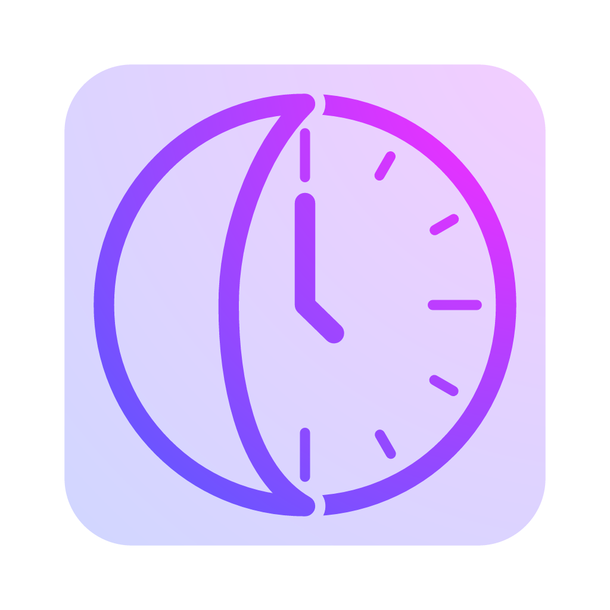

<p align="center">
  
</p>

# Curfew

Set your limits once. Windows keeps you to them.

Curfew closes the apps you choose when you've hit your daily time or you're outside your allowed hours. It started as a way to keep my own gaming in check, but it works with any app.

Curfew was called HardCap before; your settings and usage history carry over automatically.

> **Get it:** download the installer (`Curfew-Setup-<version>.exe`) from the [latest release](https://github.com/SanjivA336/AppTime-Limiter/releases/latest) and run it. It installs for your account only (no admin prompt) and shows up in Add or remove programs. Windows may warn about an unknown publisher, because the installer isn't code-signed.

## How it works

Put apps in a **group**, like "Games". Each group gets a weekly schedule made of 30-minute cells. Paint each cell one of three ways:

| Cell | What it means |
| --- | --- |
| ⬜ **Free** (grey) | Play away. Your time is tracked, but it's not counted against you. |
| 🟦 **Limited** | Allowed, but the minutes come out of your daily budget. |
| 🟥 **Blocked** | Not right now. The app is closed as soon as it's spotted. |

Every group has its own **daily budget** for each day of the week: a pot of minutes that only drains during that group's Limited time and refills at midnight (or whenever you set a new day to start, see Settings). Time spent in one group never uses up another group's budget. When a group's pot is empty, its Limited apps get closed too.

That lets you do things like *3 hours on weekends between 6 and 11 PM, and 2 hours on weekdays between 8 and 10 PM*. Paint the windows, then set each day's budget in the box above its column. The window says *when* you can play, and the budget says *how long*.

You also get a heads-up before the axe falls, like *"You have 5 minutes left of Games."* Pick when (up to three warnings per group).

When an app has to go, it's asked nicely first so it can save. If it hasn't closed after 3 seconds, it's closed for it.

## What you get

- A card for each group, showing its color, its first few apps (with their icons), and where it stands right now: Limited with the time you have left, or Free or Blocked along with when that ends (like "Blocked until today at 6:00 PM"). If you've used up the day's budget, a Limited group shows as Blocked until the next Free time, or until the budget resets
- Groups with Limited time get a bar along the bottom of their card: green, blue or red for the state right now, shrinking as the day's budget is spent. It glows while one of the group's apps is running, and drifting stripes and a pulsing glow show when that app is using up your budget
- Click a card to edit that group, with its name, color, apps and warnings on one tab and its schedule on another. Nothing changes until you press **Save changes**: closing the window cancels, and **Revert** puts everything back without closing
- An optional **Edit friction** for each group: a wait from 5 seconds up to 5 minutes before the group can be opened. It opens to nothing but a countdown, and you can't see or change anything about it (including deleting it) until it reaches zero. Every time you open it, the wait starts over. The countdown only runs while its window is in front, so you can't sit it out in the background
- Each group has its own budget for each day of the week, set right above that day's column (it appears once the group has some Limited time)
- A paint-it-yourself weekly grid, plus "copy this day to…" (it copies the day's budget too) so you don't repeat yourself
- Warnings before time runs out, and an optional per-group **grace period** (up to 5 minutes) to save when a limit starts while an app is running. An app opened during a block is closed straight away
- **Pause** a group for a while (30 minutes, a few hours, until a day and time, or until you resume it). A paused group is treated as Free. Pausing lives in the group's settings, so it waits behind the Edit friction. While a group is paused its Edit friction is ignored (the saved setting is not changed, and it applies again when the pause ends).
- **What counts** (per group): the budget can be spent any time the group's apps are running (the default), or only when one of them is in front, which stops background helpers and a forgotten launcher from eating your budget. Both amounts are always recorded, closing an app never depends on which you pick, and Microsoft Store apps are not recognised as "in front".
- **Launch friction** (per group, off by default): when one of a group's apps starts, it is frozen and a small window like the quit one appears; its countdown (up to 60 seconds) only runs while that window is in front, then you choose to open the app or not. Closing the window, or leaving it for 5 minutes, closes the app. It never closes and relaunches an app, a paused group skips it, and an app that can't be frozen (some games with anti-cheat) is left alone with a notice. Freezing is not tampering with a game, but a freeze in the middle of a launch can upset online games, so try a short wait first.
- **Away** (off by default, in Settings): after 1 to 60 minutes without keyboard or mouse input, time stops counting toward budgets and in Analytics until you are back. Limits are still enforced, and game controllers are not detected, so controller play can look like being away.
- A **Settings** page (bottom of the sidebar): choose when your **daily reset** happens (say 4 AM if you stay up late), set a **Global friction** wait before opening the settings or quitting, with optional **frictionless hours** when there is no wait, and export or import your settings. Like a group, the page works on a draft: nothing changes until you press "Save changes", and "Revert" puts everything back
- An **Analytics** page, in the style of Screen Time. Pick any mix of groups (or none, or "Select all"), and look at a **day**, a **week** or a **month**, stepping back as far as you like (it says "No data for…" when a period is empty). Each view has a headline number with how it compares with earlier weeks, a few totals, and a bar for each group or app:
  - **Day:** stacked columns for each hour of the day, split by group (hour-by-hour detail is recorded from the version that added it onward)
  - **Week:** stacked columns for each day, split by group; click a day to open it
  - **Month:** a calendar with a pie and the day's total in every day that has usage, and the week number on the left; click a day to open it, or a week number to open that week; point at a day for a text summary of its groups and percentages

  Point at a group in the day or week charts, or in the bars, and it fades into the apps that make it up. Usage is kept for 3 months. Time for each app is recorded from the version that added this page onward; earlier days only have a total per group
- Add apps by picking a running one, searching your installed apps, or browsing for the program file. Anti-cheat and helper programs are flagged, because they run all day and would eat your budget
- A tray icon, so it keeps working after you close the window
- An option to start with Windows
- Quitting from the tray waits too: as long as your longest Edit friction, or the Global friction
- No admin rights, no account, no cloud, no tracking. Everything stays on your PC.
- Safety rails: it won't let you limit core Windows stuff like `explorer`, so you can't lock yourself out of your own desktop

## Try it

You'll need Windows 10 or 11 and the [.NET 10 SDK](https://dotnet.microsoft.com/download/dotnet/10.0) or newer.

```powershell
git clone <this repo>
cd <this repo>
dotnet run --project src/Curfew.App
```

To run the tests:

```powershell
dotnet test
```

Want a standalone build?

```powershell
dotnet publish src/Curfew.App -c Release -r win-x64 --self-contained false -o publish
```

Want the installer? Install [Inno Setup 6](https://jrsoftware.org/isinfo.php) (`winget install JRSoftware.InnoSetup`), then run `tools/build-installer.ps1 -Version 1.2.0`. It publishes the app and writes `artifacts/Curfew-Setup-1.2.0.exe`. The script is `installer/Curfew.iss`; never change its `AppId`, or an upgrade would install a second copy.

Working in VS Code? Press **F5**. The "dev data" profile keeps its settings in a throwaway `.dev-data` folder and never registers itself to start with Windows, so it can't mess with your real setup. Tasks for build, test and publish are in the Terminal > Run Task menu.

If you turn on *Start with Windows* and later move the `.exe`, just switch the setting off and on again so it learns the new location.

## Where your stuff lives

Everything is in `%LOCALAPPDATA%\Curfew\`:

- `settings.json`: your groups, with each group's schedule, warnings, edit friction, grace period, pause, what counts and daily budgets, plus the general settings (daily reset, global friction, frictionless hours, away). Older files are upgraded automatically
- `usage.json`: how long each group, and each of its apps, has been running and how long one of them was in front, day by day and hour by hour. Days older than 3 months are deleted automatically
- `app.log`: a small log, handy if something looks off

Settings are plain text, so you can edit them by hand. Each day's schedule is 48 letters, one per half hour from midnight: `F` is Free, `L` is Limited, `B` is Blocked. Days are listed Sunday first. If the app can't read something, it plays it safe and treats it as Blocked.

If a file ever gets corrupted, the app saves a copy (`*.corrupt-<time>.json`) and starts fresh. It won't quietly throw your data away.

## Good to know

This is a self-control tool, not a security system.

- It runs as you, so anyone on your Windows account can quit it. It's built to give *you* a bit of friction, not to stop a determined you.
- It can't close an app that's running as administrator unless it's running as administrator too. If that happens, it'll tell you.
- The app picker finds apps from the Start Menu and the registry. Some games (many from Steam or Epic) aren't listed there: use Browse and pick the game's program file. A launcher and the game it starts are usually two different programs, so add the one you actually want to limit (or both).
- It doesn't block websites. A browser extension like [LeechBlock NG](https://www.proginosko.com/leechblock/) pairs nicely with it.

## What's done, what's next

**Done**
- [x] Groups and the app picker
- [x] Weekly schedule grid
- [x] Daily budgets, set separately for each group and each day
- [x] Warning notifications
- [x] Closing apps when time's up
- [x] Tray icon and start with Windows
- [x] Browse for or search any app, not only running ones
- [x] A grace period before an app is closed
- [x] Pause a group for a while
- [x] What counts: count time only when an app is in front
- [x] Stop counting time while you are away from the computer
- [x] Launch friction: hold a newly started app behind a countdown
- [x] A custom daily reset
- [x] A Global friction wait (with frictionless hours) before opening the settings or quitting, and an Edit friction for each group
- [x] Export and import your settings
- [x] Analytics page: see where your time actually goes

**Planned**
- [ ] Website blocking through a browser extension
- [ ] Pick a different activity instead of waiting, such as a few math questions, a puzzle or typing a sentence
- [x] An installer, so you don't need to build it yourself

Got an idea? Open an issue and say hi.

## Project layout

```
src/Curfew.Core      The brains: schedule, budget, warnings, settings (no UI)
src/Curfew.App       The Windows app: window, tray icon, notifications
tests/Curfew.Tests   Tests for the brains
```

The decisions about what to close and when to warn live in `EnforcementEngine` and `LimitForecast`. They're told the time and the running apps rather than looking them up, which is why the tests can try any scenario without waiting around for the real clock.

## Patch notes

**v1.3.3**: The installer now force-quits a running Curfew instead of asking it to close, so a wait set in the app (Global friction) no longer makes the installer wait too.

**v1.3.2**: Fixed a glitch where the few seconds around midnight (or the daily reset) were filed under the new day's last hour, so a day could show use in an hour that hadn't happened yet. The version now shows next to the name in the title bar, and the Launch friction card warns that freezing an app may break things (especially games with anti-cheat).

**v1.3.1**: Analytics shows exactly what was recorded again. Apps and groups running at the same time each count, so an hour can add up to more than an hour (the Day view says so when it happens), and an app's hover card shows its own time instead of a share of its group's.

**v1.3.0**: HardCap is now Curfew, with a new logo; installing over HardCap upgrades it and keeps your settings. Launch friction (a wait before a new app opens), a sidebar layout for the group editor and Settings, Save and Revert on the Settings page, and clearer names (Edit friction, Global friction, Frictionless hours).

**v1.2.0**: Optional away detection in Settings (no counting after a set time without keyboard or mouse input). A group's card only animates while its budget is really draining. Analytics no longer shows more than 60 minutes in an hour or 24 hours in a day when groups or apps overlap.

**v1.1.0**: Each group can count its budget only while one of its apps is in front (both amounts are recorded). Adds an installer.

**v1.0.0**: First stable release.

**v0**: First working version. Groups, weekly schedule, per-group daily budgets, warnings, locks, grace periods, pausing, a settings page (new-day time, waits and open hours, export/import), searching and browsing for apps, an analytics page, closing apps, tray icon.

## Contributing

Thanks for stopping by! This is early and the design is still shifting, so please open an issue before sending a pull request. And run `dotnet test` first.

## License

[MIT](LICENSE). Do what you like with it.
